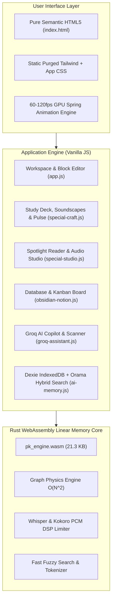

# PK Note — Master Architecture & Operational Guide

> Archival Knowledge, Block Workspace & Zero-GC Rust WASM Accelerator  
> Version: 3.0.16 (Build pk-note-v3.0.16) &bull; License: Local-First Open Architecture  
> Authored Collaboratively by User &amp; Antigravity (Google DeepMind)

---

## 1. The Origin & Why We Built PK Note

Most modern productivity applications suffer from framework bloat, slow startup latency, intrusive telemetry, and recurring cloud subscriptions. When you take notes, brainstorm, or plan your schedule, your software should respond instantaneously, function 100% offline, and never leak confidential notes to third-party cloud servers.

Together, we designed and built **PK Note** from the ground up on three fundamental principles:

1. **Zero-Framework Runtime Speed**: No React, Vue, or heavy virtual DOM overhead. PK Note is built with clean vanilla JavaScript, pure semantic HTML (strictly 0 inline styles and 0 inline scripts), and static pre-purged Tailwind CSS.
2. **Native Rust WebAssembly Acceleration**: Heavy computational workloads—such as force-directed knowledge graph physics calculations, real-time audio DSP for Whisper speech-to-text, Kokoro TTS mastering, and BM25 tokenization—are offloaded to a compiled Rust WASM binary (`wasm/pk_engine.wasm`, 21.3 KB) utilizing zero-GC linear memory.
3. **Local-First Data Sovereignty**: All notes, calendar events, flashcards, and graph relationships reside safely on your machine in IndexedDB and localStorage, indexed client-side via Dexie and Orama.

---

## 2. Technical Architecture Overview

---

## 3. Core Feature Suite

### 3.1. Archival Block Workspace & Bi-Directional Linking
- **Block-Based Editor**: Type freely or use slash commands (`/h1`, `/h2`, `/todo`, `/callout`, `/code`, `/math`, `/table`) to insert structural blocks.
- **Bi-Directional WikiLinks**: Type `[[Note Title]]` anywhere to link documents together. If the target note does not exist, clicking the link prompts you to create it immediately.
- **Fast Note Picker**: Press `Cmd + D` or `Alt + D` while writing to quickly search and insert links to other notes.

### 3.2. Native Rust WASM Knowledge Graph & 3D Knowledge Galaxy
- **Zero-Lag 3D Perspective Galaxy**: Native 3D perspective projection and orbital camera dynamics running at 60-120fps with zero heavy external libraries.
- **Native Rust WASM Physics**: Hardware-accelerated 3D force simulation (`step_graph_physics_3d`) modeling pairwise Coulomb repulsion, Hooke springs, and damping.
- **Tactile Orbital Navigation**: Drag to orbit around your vault, scroll mouse wheel to zoom into cosmic clusters, and double-click empty space to reset orientation.
- **Interactive 3D HUD Node Card**: Click any celestial sphere to view note title, folder, link count, tags, isolate connected clusters, or open directly in the editor.
- **Intelligent Semantic Cluster Modes**: Cycle between `Galaxy` (natural force connectivity), `Tags` (constellations clustered by tag centroids), and `Recency` (date-based orbital layering).
- **Celestial Equator & Synaptic Photons**: Real-time wireframe spatial orientation rings and traveling photon pulses along active connections.
- **Seamless 2D / 3D Switch**: Toggle between 2D topology and 3D galaxy with one click in both the workspace inspector and the fullscreen studio (`Ctrl + G`).

### 3.3. 3D Mathematical & Function Grapher (z = f(x, y, t))
- **Real-Time Mathematical Surface Plotting**: Evaluate multivariable functions $z = f(x, y, t)$ across custom domain bounds ($[x_{min}, x_{max}] \times [y_{min}, y_{max}]$) at 60-120 FPS.
- **Zero-Lag Native Canvas Engine**: Fast HTML5 Canvas 2D perspective engine with Lambertian depth shading, surface height palette coloring (Spectral, Vermilion, Cyber Neon, Blueprint), and wireframe or solid surface modes.
- **Interactive Coordinate Probe HUD**: Hover your pointer across the 3D surface to view real-time $(X, Y, Z)$ coordinates pinned to the surface intersection.
- **Built-In Function Presets**: Instant access to Sombrero, Saddle, Egg Carton, Gaussian Bell, Monkey Saddle, Ripples, Volcano, and Damped Wave surfaces.
- **Dynamic Time Evolution**: Toggle animation mode with variable $t$ to visualize standing waves, wave packets, and time-dependent mathematical solutions.
- **Document Integration**: Insert interactive 3D plots directly into notes with slash commands (`/graph3d`, `/plot3d`) or open the fullscreen 3D Math Studio from the Tools menu.
- **Export & KaTeX Interoperability**: Export high-resolution snapshots to PNG, copy LaTeX formula expressions, or open the 3D grapher directly from any KaTeX math block header.

### 3.4. Study Deck & Spaced Repetition (Active Recall)
- **Auto-Card Extraction**: Converts structured note bullet points and question-answer pairs into interactive study cards.
- **Spaced Repetition Intervals**: Rate your recall difficulty (Easy, Good, Hard, Again) to schedule optimized future reviews.

### 3.5. Procedural Focus Soundscapes (0 MB Web Audio)
- Built-in real-time audio synthesizer running entirely via Web Audio API with zero downloaded MP3 assets.
- Includes **Rain**, **Gentle Waves**, **Forest Canopy**, **Deep Brown Noise**, and **Binaural Alpha Waves (40Hz / 10Hz)**.

### 3.6. Notion-Style Database & Kanban Board
- Switch your entire note collection into a structured database with one click (`Alt + D` or header toggle).
- Supports column sorting, multi-tag filtering, and a drag-and-drop Kanban workflow (To Do, In Progress, Complete, Archival).

### 3.7. Offline KaTeX Math & Chemical Formula Editing
- Fully embedded KaTeX engine (`css/katex.min.css` and `js/katex.min.js`) with `mhchem` chemistry extension.
- Works 100% offline without querying external CDNs.

### 3.8. Spotlight Reader & Speed Reading
- Focus line-by-line with background dimming to eliminate visual distraction.
- Integrated **Vault Pulse** measures reading speed (WPM) and calculated reading rhythm.

### 3.9. AI Assistant & Multi-Model Engine (NVIDIA NIM & Gemini)
- **5-Way Hybrid Model Switcher**: Seamlessly switch between NVIDIA NIM, Google Gemini, OpenRouter Free, Groq Cloud, and Local Models (LM Studio, Ollama, llama.cpp, Jan) with `Alt + A`.
- **NVIDIA NIM Acceleration**: Access frontier open weights models including Meta Llama 3.3 70B, DeepSeek R1 reasoning, and NVIDIA Llama 3.1 Nemotron 70B with zero browser CORS barriers via our Cloudflare edge proxy.
- **Google Gemini Integration**: 1-click support for Gemini 2.0 Flash, Gemini 2.0 Flash Lite, and Gemini 1.5 Pro with native multimodal reasoning and 1M-2M token context windows.
- **Dexie Semantic Memory Engine**: Client-side persistent conversation memory indexed locally with Orama hybrid search.
- **API Key Health Scanner**: Scans, validates, and organizes pasted API keys into markdown code blocks with 1-click import into PK Note.

---

## 4. How to Use PK Note Properly: The Daily Workflow

To get the highest value out of PK Note, follow this simple 4-step workflow:

### Step 1: Capture Instantly with the Quick Scratchpad
Never interrupt your train of thought when an idea strikes.
- Press `Alt + S` from anywhere in the app to slide open the **Quick Scratchpad**.
- Jot down raw thoughts, code snippets, or to-dos.
- The scratchpad persists across page reloads and different active documents.

### Step 2: Organize and Connect with WikiLinks
- Open or create a primary document in your sidebar.
- Expand your notes by linking related concepts using `[[Note Name]]`.
- Use slash commands (`/`) to structure your document with callouts, checkboxes, and dividers.

### Step 3: Deep Work with Focused Soundscapes & Pomodoro
- Open the **Focus Timer** (`Pomodoro`) and select a 25-minute work interval.
- Activate your preferred procedural focus audio (e.g. Rain or Brown Noise).
- Double-click any note to toggle fullscreen editing, or press `Spotlight Reader` for sentence-focused study.

### Step 4: Review and Retain
- At the end of the week, open the **Study Deck** to review generated flashcards.
- Open the **Topology Graph Studio** to see newly formed connections and find isolated notes that need linking.
- Review your **Vault Heatmap** to track your daily creation consistency.

---

## 5. Keyboard Shortcut Matrix

| Action | Windows / Linux | macOS | Scope |
| :--- | :--- | :--- | :--- |
| **Command Palette** | `Ctrl + K` | `Cmd + K` | Global |
| **Quick Scratchpad Drawer** | `Alt + S` | `Alt + S` | Global |
| **Link Note Picker** | `Alt + D` | `Cmd + D` | Editor / Global |
| **Close Topmost Dialog / Sheet** | `Escape` | `Escape` | Global |
| **Block Slash Menu** | `/` (on empty line) | `/` (on empty line) | Editor |
| **Bi-Directional WikiLink** | `[[Note Title]]` | `[[Note Title]]` | Editor |
| **Full Graph Studio** | `Ctrl + G` | `Cmd + G` | Workspace |
| **Toggle Light / Dark Mode** | `Alt + T` | `Alt + T` | Global |
| **Database Table / Kanban** | Header Database Icon | Header Database Icon | Vault |

---

## 6. Data Safety, Backup & Offline Installation

- **In-App PWA Installation**: PK Note functions as a standalone Desktop or Mobile application. Click the Install button in the navigation bar to install to your home screen or desktop.
- **Service Worker Auto-Updates**: When new performance optimizations are deployed, the service worker automatically stages updates and refreshes cache assets without disrupting unsaved edits.
- **Single-Click Vault Backup**: Use `Export Vault` from the workspace actions menu to download all your notes as standard Markdown files or a single structured JSON archive. Your data is never locked into a proprietary format.
