# PK Note

> Archival Knowledge, Block Workspace & Zero-GC Rust WASM Accelerator  
> Version 3.0.16 (Build pk-note-v3.0.16) &bull; Local-First Open Architecture &bull; 100% Offline PWA  
> Authored Collaboratively by User &amp; Antigravity (Google DeepMind)

---

## Overview

PK Note is a high-performance, local-first personal knowledge management (PKM) and block calendar workspace built on tactile ink-and-paper aesthetics, Swiss grid typography, bi-directional graph topology, and a native Rust WebAssembly acceleration core.

Designed with a strict zero-framework architecture—zero React, Vue, or heavy virtual DOM runtime overhead—PK Note loads in under 50 milliseconds, operates completely offline, and delivers fluid 60 to 120 FPS hardware-accelerated animations across desktop, tablet, and mobile devices.

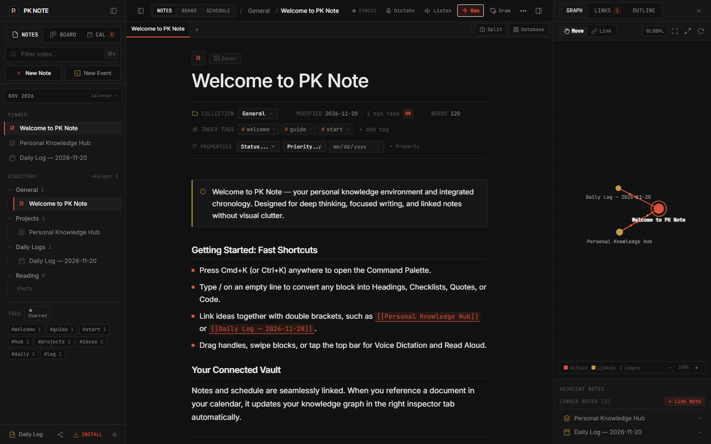

---

## Visual Showcase

### 3D Mathematical & Function Grapher Studio

| Fullscreen 3D Math Grapher Studio | Inline Note 3D Graph Block (`/graph3d`) |
| :---: | :---: |
| 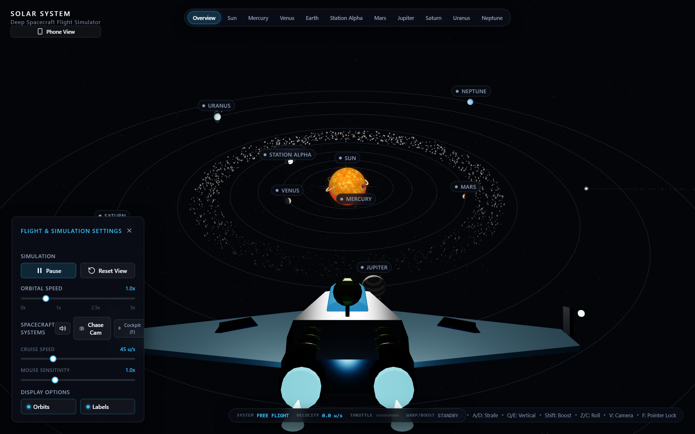 |  |
| *Real-time evaluation of $z = f(x, y, t)$, Lambertian depth lighting, coordinate probe HUD, and presets* | *Interactive 3D mathematical surfaces embedded directly into documents with full orbit and zoom controls* |

### AI Assistant & Multi-Model Engine (NVIDIA NIM & Gemini)

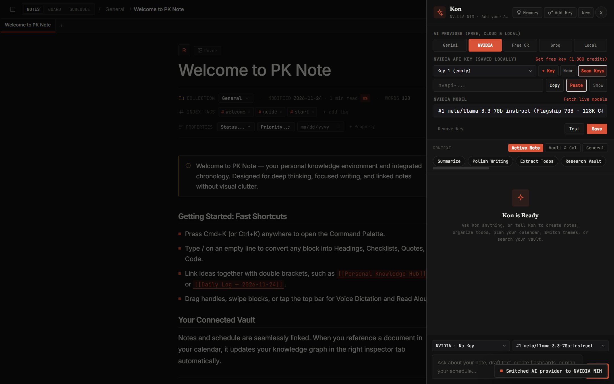
*5-way provider switcher featuring NVIDIA NIM (Llama 3.3 70B, DeepSeek R1, Nemotron) accelerated via Cloudflare edge proxy, Google Gemini 2.0/1.5, OpenRouter Free, Groq Cloud, and local servers with zero CORS barriers.*

### 3D Knowledge Galaxy & Orbital Topology Graph

| Fullscreen 3D Knowledge Galaxy Studio (`Ctrl+G`) | Right Inspector 3D Galaxy View |
| :---: | :---: |
|  | 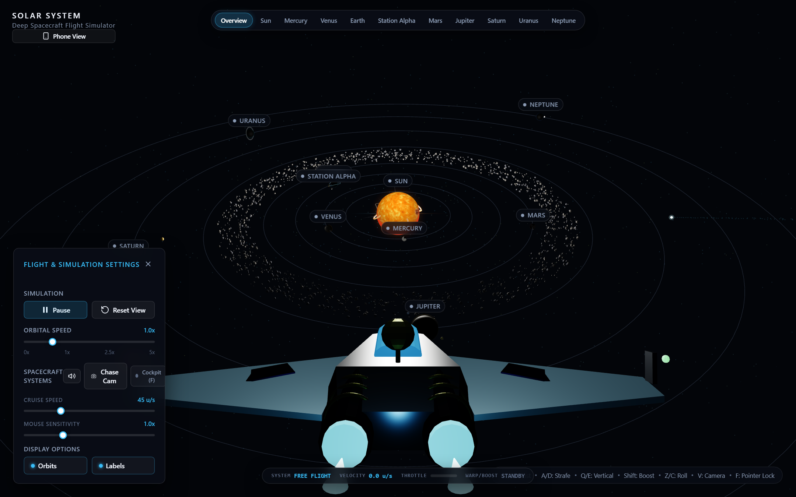 |
| *True 3D orbital perspective with WASM physics, celestial equator grid, and HUD node inspection* | *Seamless 2D/3D toggle in the workspace inspector beside live editor* |

### Desktop Workspace (Dark & Light Modes)

| Dark Theme (Default) | Light Archival Paper Theme |
| :---: | :---: |
|  | 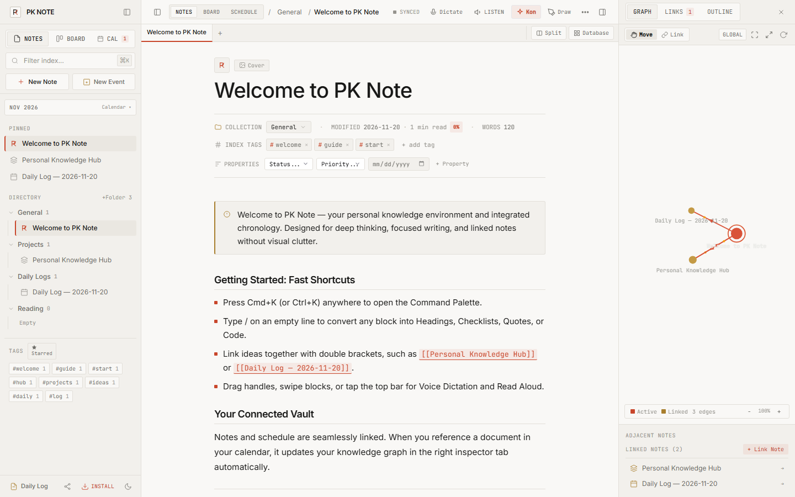 |
| *High-contrast archival dark interface with real-time graph inspector* | *Tactile vellum paper aesthetic with Swiss grid typography* |

### Integrated Calendar & Fast Command Palette

| Monthly Calendar & Event Management | Instant Command Palette (`Ctrl+K`) |
| :---: | :---: |
| 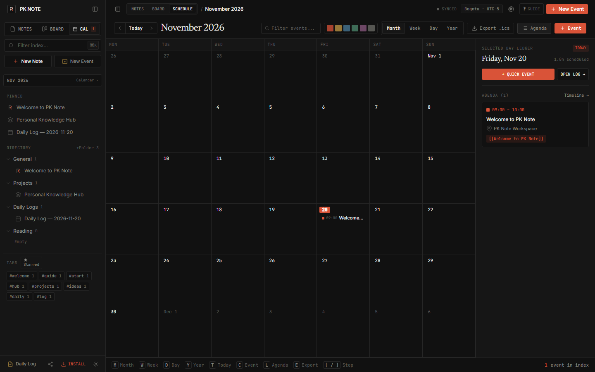 | 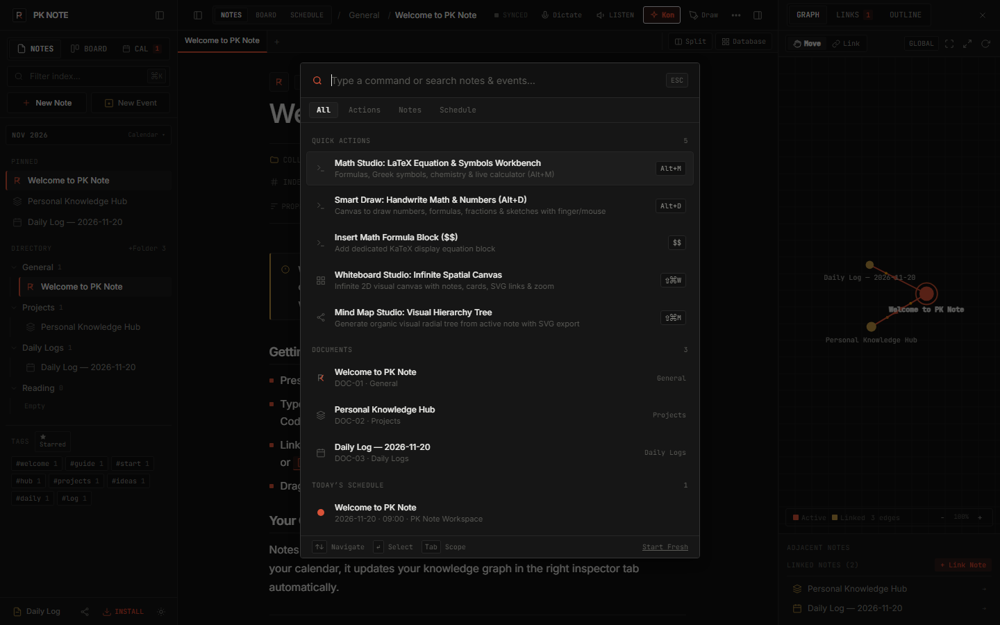 |
| *Schedule planner with note links and quick event creation* | *Real-time fuzzy search across all notes, tags, and tools* |

### Interactive Study Deck & Smart Draw Canvas

| Study Deck & Spaced Repetition Flashcards | Smart Draw Vector Canvas |
| :---: | :---: |
| 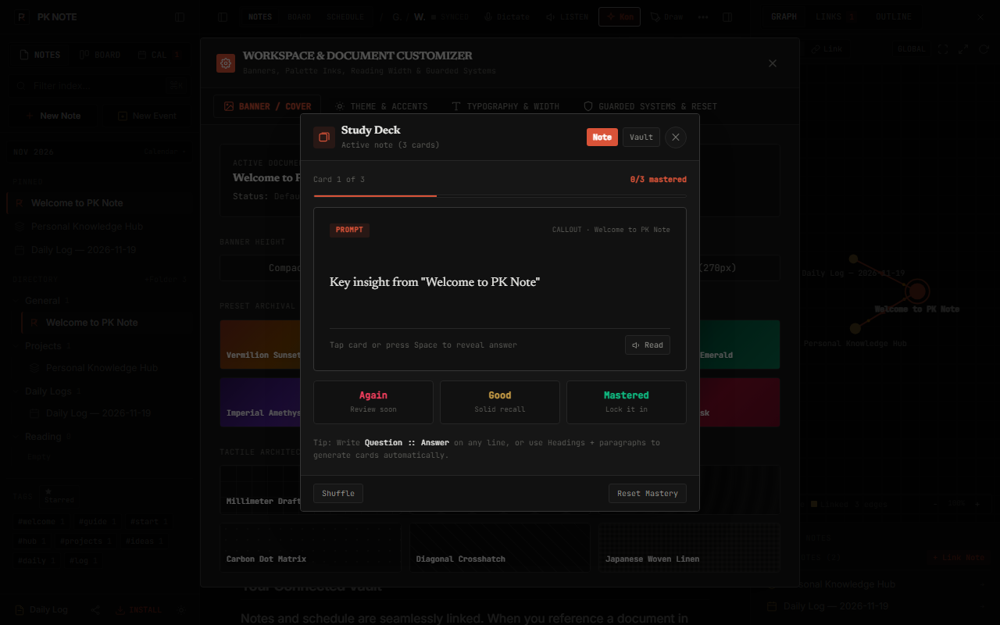 | 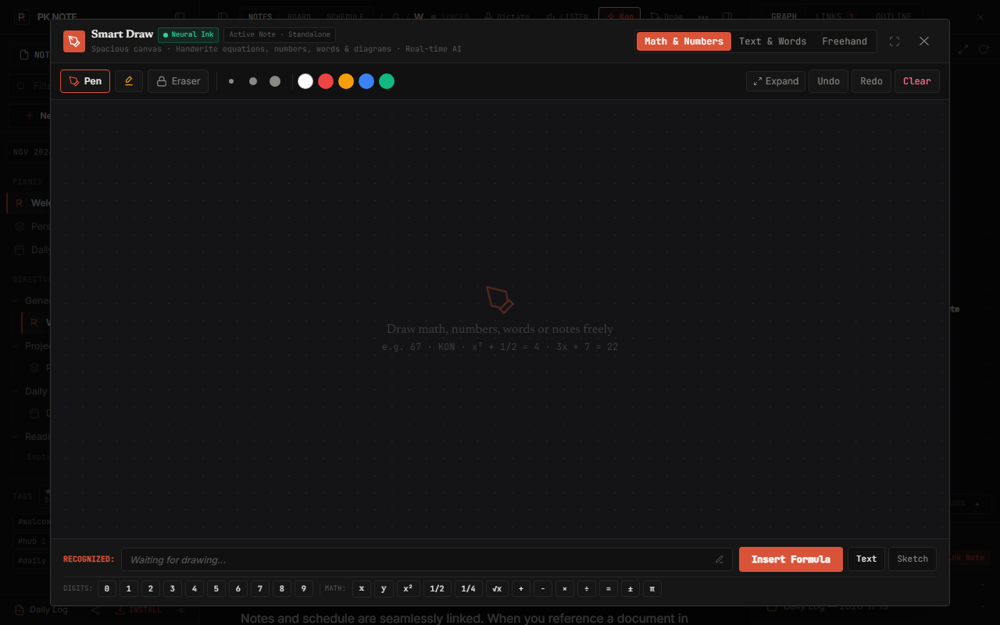 |
| *Auto-extracted flashcards with active recall spaced repetition* | *Vector sketching whiteboard with stroke smoothing and note embedding* |

### Adaptive Mobile & Tablet Experience

| Mobile Phone (390px Viewport) | Tablet (768px Viewport) |
| :---: | :---: |
| 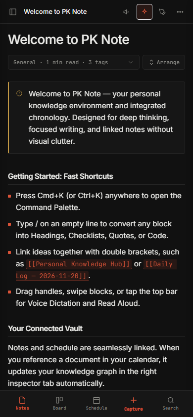 | 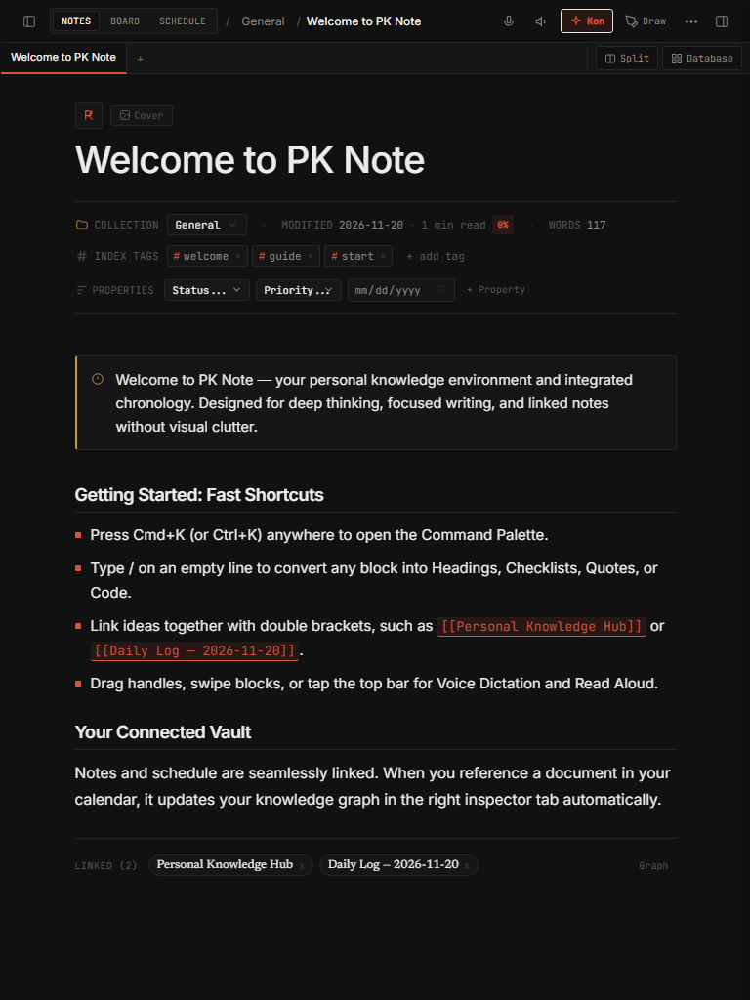 |
| *One-thumb ergonomic bottom navigation and touch gutters* | *Adaptive dual-pane layout with responsive sidebar drawers* |

---

## Core Pillars & Architecture

### 1. Zero-Framework Runtime Speed
- **Pure Semantic HTML5 Contract**: Exactly 0 `<style>` tags and 0 inline `<script>` tags in [`index.html`](file:///e:/Code/for%20note/index.html).
- **Static Pre-Purged Tailwind CSS**: Replaces the 350 KB Tailwind CDN runtime compiler with a 52 KB static production build ([`css/tailwind.min.css`](file:///e:/Code/for%20note/css/tailwind.min.css)) and custom modular stylesheets ([`css/app.min.css`](file:///e:/Code/for%20note/css/app.min.css)).
- **Vanilla Modular JavaScript**: Lightweight modules for boot, app logic, studio tools, and databases with zero runtime dependencies.

### 2. Native Rust WebAssembly Accelerator
- Offloads computationally heavy workloads to a compiled Rust WASM binary ([`wasm/pk_engine.wasm`](file:///e:/Code/for%20note/wasm/pk_engine.wasm), 21.3 KB) operating in linear zero-GC memory.
- **Graph Physics Engine**: Accelerates O(N^2) force-directed graph node repulsion and edge attraction calculations for thousands of nodes.
- **Audio DSP Pipeline**: Real-time 24kHz/16kHz PCM audio resampling, DC offset removal, and soft-limiter mastering for Whisper speech-to-text and Kokoro-82M neural TTS.
- **Tokenization & Fuzzy Scorer**: Fast sub-millisecond BM25 term tokenization and case-insensitive search ranking.

### 3. Local-First Data Sovereignty & Offline Search
- All documents, events, flashcards, and graph relationships are stored locally in **IndexedDB** and `localStorage`.
- Powered by **Dexie** and **Orama** ([`js/ai-memory.min.js`](file:///e:/Code/for%20note/js/ai-memory.min.js)) for offline hybrid full-text BM25 and vector similarity search.
- 100% offline mathematical and chemical typesetting with embedded KaTeX and mhchem ([`css/katex.min.css`](file:///e:/Code/for%20note/css/katex.min.css), [`js/katex.min.js`](file:///e:/Code/for%20note/js/katex.min.js)).

### 4. 60-120 FPS GPU Spring Animations
- Custom hardware-accelerated CSS animations (`.animate-backdrop`, `.animate-modal-card`, `.animate-sheet-in`, `.animate-menu`, `.animate-scratchpad-in`).
- Unified modal lifecycle management (`openModalWithAnimation` and `closeModalWithAnimation`) ensuring zero jarring 0ms cutoffs.
- Universal `Escape` key handling across all 34 active interactive dialogs, bottom sheets, and popovers.

---

## Technical Architecture

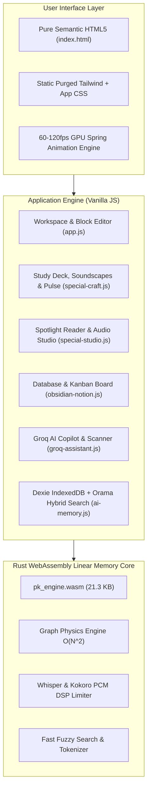

---

## Feature Matrix

| Feature | Description | Shortcut / Access |
|---|---|---|
| **Block Workspace** | Rich text block editor with slash commands (`/h1`, `/todo`, `/callout`, `/math`, `/code`, `/graph3d`) | `/` on empty line |
| **AI Copilot & Multi-Model Engine** | 5-way hybrid AI assistant supporting NVIDIA NIM, Google Gemini, OpenRouter Free, Groq Cloud, and Local Models (LM Studio / Ollama) with Dexie semantic memory | `Alt+A` or Sidebar Sparkle |
| **3D Math & Surface Grapher** | Real-time mathematical function & surface plotter ($z = f(x, y, t)$) with Lambertian depth shading, coordinate probe HUD, dynamic presets, animated time parameter, and inline note blocks | Slash command `/graph3d` or Tools Menu |
| **Bi-Directional WikiLinks** | Connect notes with auto-completing links that automatically build knowledge graph edges | `[[Note Title]]` or `Alt+D` |
| **Knowledge Graph & 3D Galaxy** | High-performance 2D and 3D force-directed topology galaxy accelerated by native Rust WASM with orbital camera, cluster modes (Galaxy, Tags, Recency), and HUD inspection | `Ctrl+G` / `Cmd+G` or Inspector Header |
| **Study Deck** | Interactive flashcard system with spaced repetition intervals (Easy, Good, Hard, Again) | Tools Menu / `Special Craft` |
| **Procedural Soundscapes** | 0 MB procedural Web Audio synthesizer: Rain, Waves, Forest Birds, Brown Noise, Binaural Beats | Tools Menu |
| **Notion-Style Database** | Vault table and Kanban board with status tags, filtering, and column sorting | Header Database Icon |
| **Quick Scratchpad** | Floating slide-out scratchpad drawer persistent across documents and calendar views | `Alt+S` |
| **Command Palette** | Lightning-fast fuzzy search for documents, calendar events, tools, and actions | `Ctrl+K` / `Cmd+K` |
| **Offline Math & Chem** | Full KaTeX and mhchem offline rendering for scientific and chemical notation | `/math` or `$$` syntax |
| **Smart Draw Canvas** | Vector drawing whiteboard with stroke smoothing, geometric shapes, and export | Tools Menu |
| **Integrated Calendar** | Monthly and daily calendar planner with color-coded event chips and note linking | Sidebar Calendar Icon |
| **Spotlight Reader** | Sentence-by-sentence distraction-free focus reader with WPM Vault Pulse telemetry | Tools Menu |

---

## Running and Installing

### 1. Desktop Browser
Open [`index.html`](file:///e:/Code/for%20note/index.html) or [`pk_note_workspace.html`](file:///e:/Code/for%20note/pk_note_workspace.html) directly in Chrome, Edge, Brave, Firefox, or Safari.

### 2. Standalone Windows Desktop App
Double-click [`PK Note.bat`](file:///e:/Code/for%20note/PK%20Note.bat) to launch PK Note in a dedicated window without browser address bars or navigation clutter.

### 3. Progressive Web App (PWA) Installation
- **Windows / macOS / Linux**: Click the **Install** button in the sidebar utility bar or the browser address bar icon.
- **Android**: Open in Chrome or Firefox, tap the menu, and select **Add to Home screen** / **Install App**.
- **iOS (iPhone & iPad)**: Open in Safari, tap **Share**, and select **Add to Home Screen** to run in fullscreen standalone mode.

---

## Building from Source

Prerequisites:
- [Node.js](https://nodejs.org/) (v18+)
- [Rust](https://rustup.rs/) with `wasm32-unknown-unknown` target (optional, pre-compiled WASM binary included)

```bash
# Clone the repository
git clone https://github.com/not-phana/PK-Note.git
cd PK-Note

# Install build dependencies
npm install

# Compile Rust WebAssembly core, purge Tailwind CSS, and minify JavaScript
node build.js
```

---

## Keyboard Shortcuts

| Shortcut (Windows/Linux) | Shortcut (macOS) | Action | Scope |
|---|---|---|---|
| `Ctrl + K` | `Cmd + K` | Open Command Palette | Global |
| `Alt + S` | `Alt + S` | Toggle Quick Scratchpad Drawer | Global |
| `Alt + D` | `Cmd + D` | Fast Link Note Picker | Editor / Global |
| `Escape` | `Escape` | Close Topmost Modal / Popover | Global |
| `Ctrl + G` | `Cmd + G` | Open Topology Graph Studio | Workspace |
| `Alt + T` | `Alt + T` | Toggle Light / Dark Theme | Global |
| `/` | `/` | Open Block Slash Command Menu | Editor (Empty Line) |
| `[[` | `[[` | Insert Bi-Directional WikiLink | Editor |

---

## Visual Identity & Brand Assets

The PK Note design language fuses archival ledger typography with dynamic knowledge graph branching:

| Asset | Description |
|---|---|
| [`pk-note-logo.svg`](file:///e:/Code/for%20note/pk-note-logo.svg) | Universal responsive horizontal brand lockup |
| [`pk-note-logo-dark.svg`](file:///e:/Code/for%20note/pk-note-logo-dark.svg) | High-contrast vector lockup for dark themes |
| [`pk-note-logo-light.svg`](file:///e:/Code/for%20note/pk-note-logo-light.svg) | High-contrast vector lockup for light vellum surfaces |
| [`pk-note-icon.svg`](file:///e:/Code/for%20note/pk-note-icon.svg) | Monogram vector application icon |
| [`favicon.svg`](file:///e:/Code/for%20note/favicon.svg) | Scalable high-contrast browser favicon |
| [`icon-192.png`](file:///e:/Code/for%20note/icon-192.png) | 192x192 mobile application icon |
| [`icon-512.png`](file:///e:/Code/for%20note/icon-512.png) | 512x512 splash screen application icon |
| [`logo-showcase.html`](file:///e:/Code/for%20note/logo-showcase.html) | Interactive brand guide & construction grid |

---

## License & Attribution

Authored and maintained collaboratively by the User and **Antigravity** (Google DeepMind).  
Open architecture for personal knowledge management, archival research, and offline-first productivity.
